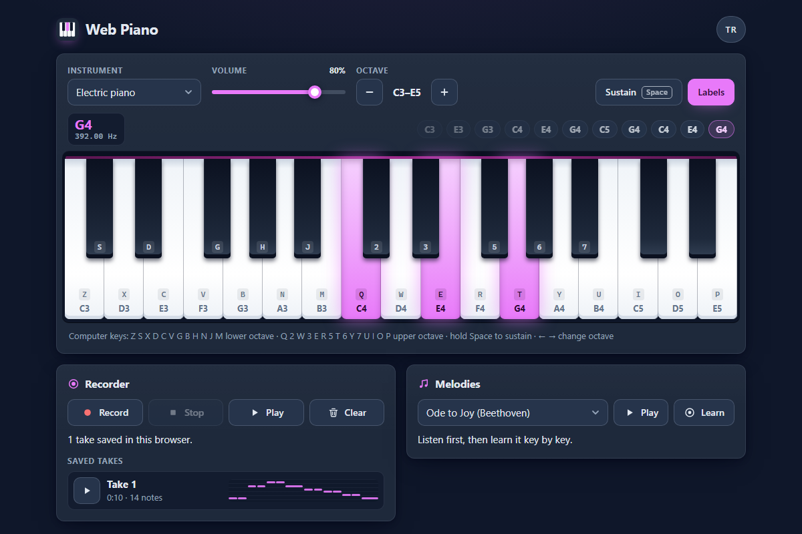

# Web Piano - play, record and learn melodies on a piano in your browser

[](#tests)
[](LICENSE)

**▶ Open the app: https://celaldrg.github.io/piano/**



A piano that runs in any modern browser, on a phone or a desktop. It has no dependencies and no build step, and no data leaves your browser.

## Features

- **Phone and desktop:** one octave plus octave buttons on a phone. Wider screens show two octaves and the D and E above them, so every computer key has its key on screen. The range is C2 to C7.
- **Ways to play:** multi-touch chords, a glissando by sliding a finger or the mouse across the keys, or the computer keyboard. Each key is also a button named after its note, so screen readers can find and play it.
- **Sounds:** four synth sounds made with the Web Audio API: electric piano, soft, flute and 8-bit chip. There is a volume slider and a sustain pedal (a button, or hold Space).
- **Key labels:** optional note names on the keys, plus the matching computer keys.
- **Visual feedback:** pressed keys glow. The last note's name and frequency show above the keys, next to a scrolling trail of recent notes.
- **Recorder:** Record, Stop, Play and Clear.
  - Up to 8 takes are kept in this browser.
  - Each take has a mini piano roll and its own play button.
- **Melodies:** three public-domain melodies: Ode to Joy, Twinkle Twinkle Little Star and Frère Jacques.
  - Listen to one and watch its keys light up.
  - Or practise it in Learn mode, which marks the next key, waits until you press it and counts mistakes.
- **Languages:** English and Turkish. Turkish note names use do-re-mi. Your language, sound, volume and label choices are remembered.

## How to use

**Touch and mouse**

- Tap a key to play it. Use several fingers for a chord, or slide along the keys for a glissando.
- **−** and **+** change the octave.
- **Sustain** keeps notes ringing until you switch it off.
- **Labels** shows or hides the names on the keys.
- Browsers allow sound only after your first interaction. On a phone the very first note starts when you lift your finger; after that, keys sound as soon as you touch them.

**Computer keyboard**

| Keys | Plays |
| --- | --- |
| `Z S X D C V G B H N J M` | Lower octave. White keys are on `Z X C V B N M`, black keys on `S D G H J`. |
| `Q 2 W 3 E R 5 T 6 Y 7 U` | Next octave up. |
| `I O P` | C, D and E above that. |
| `Space` (hold) | Sustain |
| `←` `→` | Octave down / up |

Keys are matched by their position on a US keyboard. On other layouts (for example Turkish Q or AZERTY), the keys in the same places work.

If a key plays a note that is off screen (for example the upper row on a phone), the keyboard scrolls to show it. The computer keys keep their notes until you change the octave.

**Recorder:** press **Record**, play, then press **Stop**.

- **Play** replays your newest take, and every take in the list has its own play button.
- **Clear** asks for a second click before it deletes your takes.

**Melodies:** pick a melody and press **Play** to listen.

- Press **Learn** to practise it. The next key pulses, and pressing it moves you on.
- Wrong keys are counted. **End lesson** stops the lesson.

## Run locally

The app is plain static files. Serve the folder with any static server, for example:

```sh
npx serve .
```

Then open the address it prints (for example http://localhost:3000).

ES modules do not load over `file://`, so opening `index.html` directly will not work. Use `http://`.

Add `?demo` to the address to see the fixed state used for the screenshot.

## Tests

```sh
node --test
```

CI runs the tests on Node.js 22. They need no packages. They cover:

- note frequencies and names;
- the computer-key mapping and octave limits;
- synth presets and envelopes;
- multi-touch and sustain note tracking;
- the recorder: timing with an injected clock, quantizing, and the JSON round trip;
- playback schedules;
- melodies and learn mode;
- the `?demo` state;
- that both languages are complete;
- the storage helper;
- the Web Audio synth, against a fake audio context, including a first tap made before sound was allowed;
- the on-screen keys, against a fake DOM: note names for screen readers and clicks without a pointer;
- code rules: no DOM in logic modules, no `eval` or `innerHTML`, and only `storage.js` touches `localStorage`.

## Project structure

```text
index.html          page markup, meta tags and favicon
style.css           dark theme, mobile-first layout
src/
  main.js           wires the page: input, rendering, settings
  piano.js          piano state: held keys, sustain, recorder, lesson
  music.js          note names and equal-temperament frequencies
  keyboard.js       visible keys, octave range, computer-key mapping
  tracker.js        which notes sound (multi-touch, sustain)
  instruments.js    synth presets and ADSR envelope
  synth.js          Web Audio voices and playback scheduler
  recorder.js       recording, quantizing and saving takes
  player.js         playback schedules for takes and melodies
  melodies.js       built-in public-domain melodies
  learn.js          learn mode
  demo.js           the fixed ?demo state
  i18n.js           English and Turkish strings and formatting
  storage.js        the only module that uses localStorage
  dom.js, keys-view.js, trail-view.js, takes-view.js   view helpers
test/               node:test suites
docs/screenshot.png
```

## License

MIT. See [LICENSE](LICENSE).

## Türkçe

**▶ Uygulamayı aç: https://celaldrg.github.io/piano/**

Telefonda da bilgisayarda da her modern tarayıcıda çalışan bir piyano. Bağımlılığı ve derleme adımı yok, hiçbir veri tarayıcının dışına çıkmaz.

### Özellikler

- **Telefon ve bilgisayar:** telefonda bir oktav ve oktav düğmeleri. Geniş ekranda iki oktav ve üstündeki Re ile Mi görünür, böylece her bilgisayar tuşunun ekranda bir tuşu olur. Aralık Do2–Do7 (C2–C7).
- **Çalma yolları:** çok parmakla akor, parmağı ya da fareyi tuşların üzerinde kaydırarak glissando, ya da bilgisayar klavyesi. Her tuş aynı zamanda notasının adını taşıyan bir düğmedir, böylece ekran okuyucular onu bulup çalabilir.
- **Sesler:** Web Audio API ile yapılmış dört ses: elektrikli piyano, yumuşak, flüt ve 8-bit çip. Ses düzeyi kaydırıcısı ve uzatma pedalı (düğme ya da basılı tutulan Boşluk) var.
- **Tuş etiketleri:** isteğe bağlı olarak tuşlarda nota adları ve karşılık gelen bilgisayar tuşları.
- **Görsel geri bildirim:** basılan tuş parlar. Son notanın adı ve frekansı tuşların üstünde, son çalınan notaların kayan şeridinin yanında görünür.
- **Kayıt:** Kaydet, Durdur, Çal ve Temizle.
  - En fazla 8 kayıt bu tarayıcıda saklanır.
  - Her kaydın küçük bir piyano rulosu ve kendi çal düğmesi var.
- **Melodiler:** kamu malı üç melodi: Neşeye Övgü, Parla Parla Küçük Yıldız ve Tembel Çocuk (Frère Jacques).
  - Bir melodiyi dinleyip tuşlarının yanışını izleyebilirsin.
  - Ya da Öğren modunda çalışabilirsin: sıradaki tuş işaretlenir, sen basana kadar beklenir ve hatalar sayılır.
- **Diller:** İngilizce ve Türkçe. Türkçede nota adları do-re-mi'dir. Dil, ses, ses düzeyi ve etiket seçimlerin hatırlanır.

### Nasıl kullanılır

**Dokunmatik ve fare**

- Bir tuşu çalmak için ona dokun. Akor için birden fazla parmak kullan, glissando için parmağını tuşların üzerinde kaydır.
- **−** ve **+** oktavı değiştirir.
- **Uzatma**, sen kapatana kadar notaları çınlatır.
- **Etiketler**, tuşlardaki adları gösterir ya da gizler.
- Tarayıcılar sese ancak ilk etkileşimden sonra izin verir. Telefonda ilk nota parmağını kaldırdığında başlar; sonrasında tuşlar dokunur dokunmaz ses verir.

**Bilgisayar klavyesi**

| Tuşlar | Çaldığı |
| --- | --- |
| `Z S X D C V G B H N J M` | Alt oktav. Beyaz tuşlar `Z X C V B N M`, siyah tuşlar `S D G H J` üzerinde. |
| `Q 2 W 3 E R 5 T 6 Y 7 U` | Bir üst oktav. |
| `I O P` | Onun üstündeki Do, Re ve Mi. |
| `Boşluk` (basılı) | Uzatma |
| `←` `→` | Oktav aşağı / yukarı |

Tuşlar ABD klavyesindeki konumlarına göre eşlenir. Başka düzenlerde (örneğin Türkçe Q ya da AZERTY) aynı yerdeki tuşlar çalışır.

Bir tuşun çaldığı nota ekranda değilse (örneğin telefonda üst sıra), klavye onu gösterecek şekilde kayar. Oktavı değiştirene kadar bilgisayar tuşları aynı notaları çalar.

**Kayıt:** **Kaydet**'e bas, çal, sonra **Durdur**'a bas.

- **Çal** en yeni kaydını çalar; listedeki her kaydın da kendi çal düğmesi var.
- **Temizle**, kayıtları silmeden önce ikinci bir tıklama ister.

**Melodiler:** bir melodi seç ve dinlemek için **Çal**'a bas.

- Çalışmak için **Öğren**'e bas. Sıradaki tuş yanıp söner; ona basınca bir sonrakine geçersin.
- Yanlış tuşlar sayılır. **Dersi bitir** dersi kapatır.

### Yerelde çalıştırma

Uygulama düz statik dosyalardan oluşur. Klasörü herhangi bir statik sunucuyla sun, örneğin:

```sh
npx serve .
```

Sonra yazdığı adresi aç (örneğin http://localhost:3000).

ES modülleri `file://` üzerinden yüklenmez, bu yüzden `index.html` dosyasını doğrudan açmak çalışmaz. `http://` kullan.

Ekran görüntüsündeki sabit durumu görmek için adrese `?demo` ekle.

### Testler

```sh
node --test
```

CI testleri Node.js 22 ile çalıştırır. Paket gerekmez. Kapsananlar:

- nota frekansları ve adları;
- bilgisayar tuşu eşlemesi ve oktav sınırları;
- ses ön ayarları ve zarfları;
- çok parmak ve uzatmada nota takibi;
- kayıt: enjekte edilen saatle zamanlama, ızgaraya oturtma ve JSON gidiş-dönüşü;
- çalma programları;
- melodiler ve öğrenme modu;
- `?demo` durumu;
- iki dilin de eksiksiz olması;
- depolama yardımcısı;
- sahte bir ses bağlamına karşı Web Audio sentezleyicisi, ses izni gelmeden yapılan ilk dokunuş dahil;
- sahte bir DOM'a karşı ekrandaki tuşlar: ekran okuyucular için nota adları ve işaretçisiz tıklamalar;
- kod kuralları: mantık modüllerinde DOM yok, `eval` ya da `innerHTML` yok, ve `localStorage`'a yalnızca `storage.js` dokunur.

### Lisans

MIT. Ayrıntı için [LICENSE](LICENSE) dosyasına bak.
